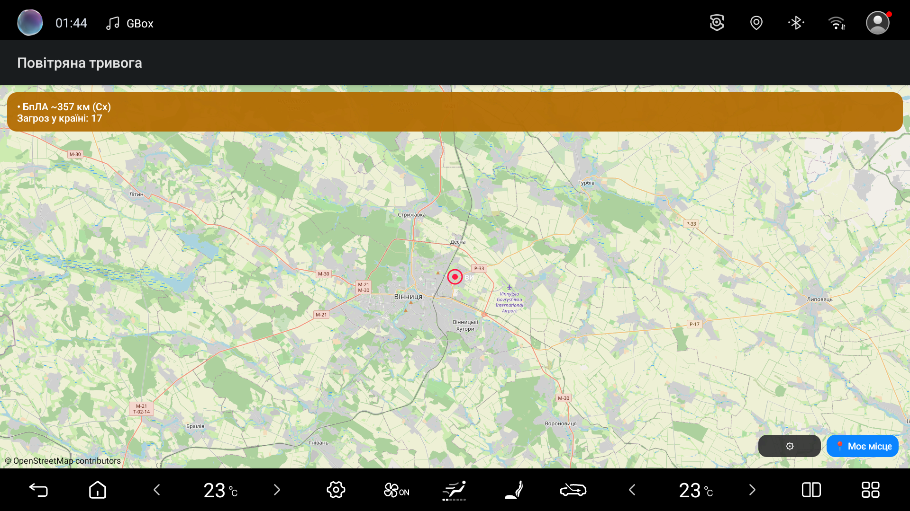
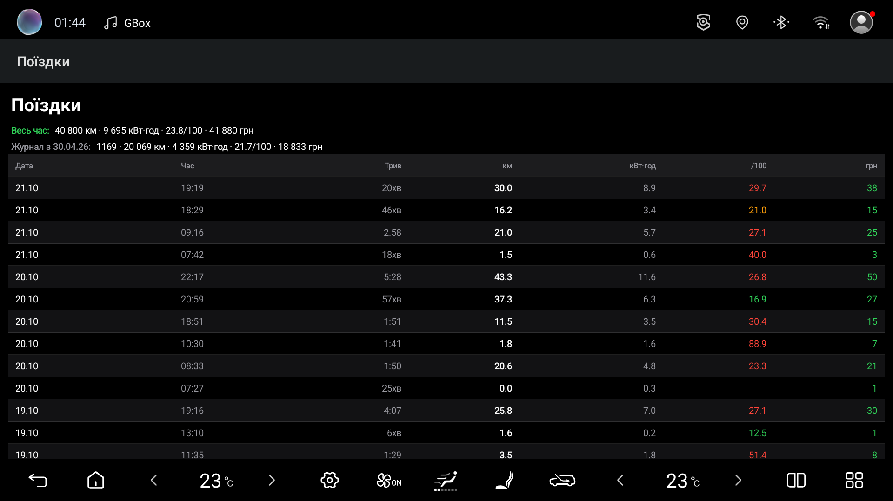
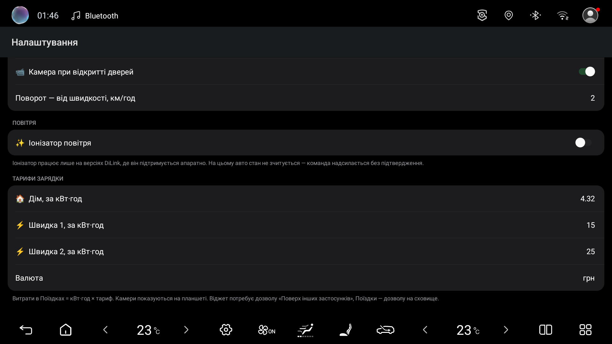

# 🚗 Car Remote

**Контроль електромобіля BYD з екрана голови (DiLink) і з Telegram — локально, без хмари.**
**Control your BYD EV from the head‑unit (DiLink) screen and from Telegram — fully local, no cloud.**

&nbsp;

&nbsp;

💬 Питання, пропозиції й звіти про роботу на інших моделях — у групі **[t.me/bydcarremote](https://t.me/bydcarremote)**.
Questions, ideas and reports from other models — in the group **[t.me/bydcarremote](https://t.me/bydcarremote)**.

> [!IMPORTANT]
> На голові має бути **увімкнений (розблокований) ADB** — бездротове налагодження.
> The head unit must have **ADB (wireless debugging) enabled**.

---

## 🇺🇦 Українською

### ✨ Можливості
| | Функція |
|---|---|
| 🔋 | **Дашборд** на екрані авто — заряд, здоров'я та темп. батареї, 12V, потужність, пробіг, двері/вікна/замок/люк, тиск шин, клімат |
| 💬 | **Керування через Telegram** — статус, клімат on/off і температура, замок/розблокування, обігрів скла, вікна, люк, багажник, пошук авто (аварійка), поріг заряду |
| 🌬️ | **Очищення повітря** в салоні (разовий цикл) |
| 🛡️ | **Карта тривог і БпЛА** (NEPTUN) — тривога по твоєму регіону, рух загроз, **сирена + українська озвучка**, кольорова індикація (зелений/жовтий/червоний) |
| 📹 | **Камери сліпих зон** — бокова камера при поворотнику, камера при відкритті дверей *(показ на планшеті)* |
| 📟 | **Плаваючий віджет** — заряд/темп/12V поверх будь‑якого застосунку |
| 🔔 | **Розумні нагадування** — перегрів батареї, «авто лишилось відкритим» |
| 📈 | **Поїздки** — повний журнал з вартістю за твоїм тарифом (дім + швидкі зарядки) |
| 🌗 | **Світла/темна тема** — автоматично під тему голови |

> ℹ️ Частина функцій керування залежить від версії DiLink і комплектації авто — якщо адреса не підтримується, функція просто не спрацює (без шкоди).

### 🔒 Приватність — «кожному своє авто»
Керування йде через бота **[@Varanbyd_bot](https://t.me/Varanbyd_bot)**. Своє авто ти **привʼязуєш кодом** — і бачиш та керуєш **лише ним**. Ніхто не має доступу до чужого авто.

### ⚙️ Встановлення
1. **Увімкни ADB** на голові (Налаштування → для розробників → бездротове налагодження). Якщо на голові вже стоять сторонні додатки — наприклад, GBox для Google-сервісів, — значить, ADB у вас уже розблоковано.
2. **[⬇ Завантаж APK](../../releases/latest)** і встанови на голову.
3. Відкрий **[@Varanbyd_bot](https://t.me/Varanbyd_bot)** у Telegram → **привʼяжи авто кодом**.
4. Готово — керуй своїм авто з телефону й з екрана голови.

---

## 🇬🇧 English

### ✨ Features
| | Feature |
|---|---|
| 🔋 | **Dashboard** on the car screen — charge, battery health & temp, 12V, power, mileage, doors/windows/lock/sunroof, tyre pressure, climate |
| 💬 | **Telegram control** — status, climate on/off & temperature, lock/unlock, defrost, windows, sunroof, trunk, find‑car (hazards), low‑battery threshold |
| 🌬️ | **Cabin air purification** (one‑shot clean cycle) |
| 🛡️ | **Air‑raid & UAV map** (NEPTUN) — alerts for your region, moving threats, **siren + Ukrainian voice**, colour‑coded (green/amber/red) |
| 📹 | **Blind‑spot cameras** — side camera on the turn signal, camera on door‑open *(shown on the tablet)* |
| 📟 | **Floating widget** — charge/temp/12V over any app |
| 🔔 | **Smart reminders** — battery overheating, “car left open” |
| 📈 | **Trips** — full journal with cost by your tariff (home + fast charging) |
| 🌗 | **Light/dark theme** — follows the head unit |

> ℹ️ Some control functions depend on the DiLink version and trim — an unsupported address simply does nothing (safe).

### 🔒 Privacy — “each to their own car”
Control runs through the **[@Varanbyd_bot](https://t.me/Varanbyd_bot)** bot. You **pair your car with a code** and can see and control **only it** — no one has access to anyone else’s car.

### ⚙️ Setup
1. **Enable ADB** on the head unit (Developer options → wireless debugging). If third-party apps are already installed on it — e.g. GBox for Google services — ADB is already unlocked.
2. **[⬇ Download the APK](../../releases/latest)** and install it on the head unit.
3. Open **[@Varanbyd_bot](https://t.me/Varanbyd_bot)** in Telegram → **pair your car with a code**.
4. Done — control your car from your phone and the head‑unit screen.

---

Zaika • Car Remote — DiLink 5.0 / BYD Song Plus. Не афілійовано з BYD.
