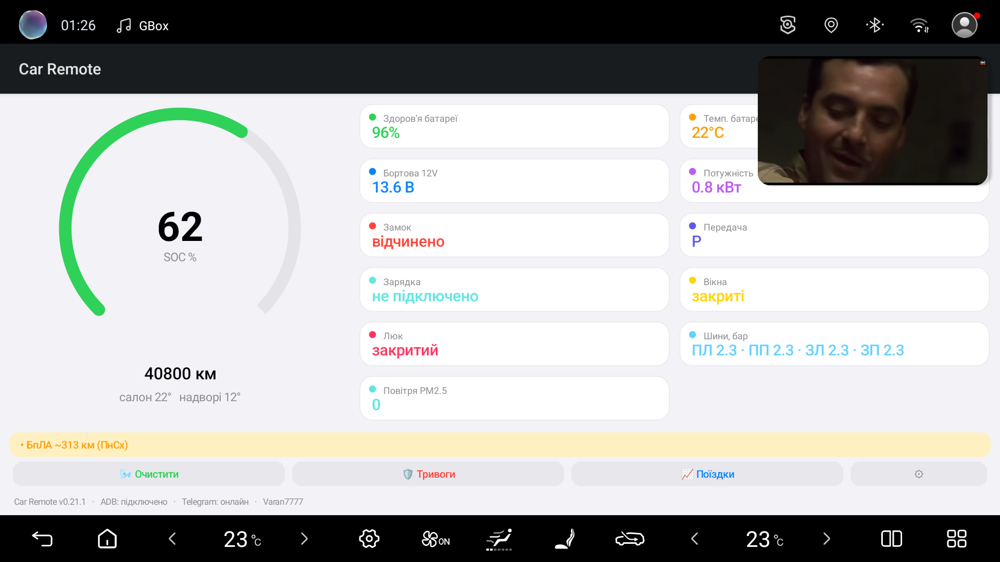
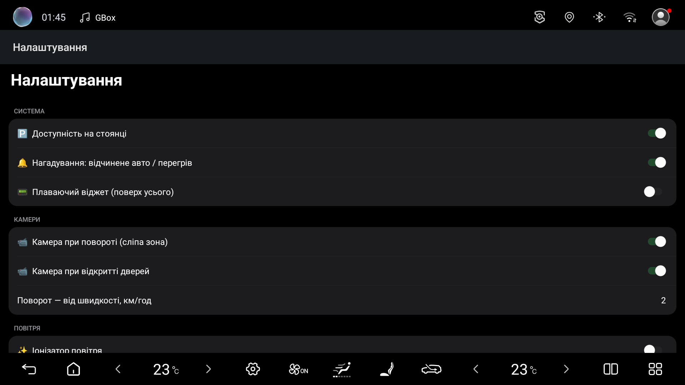

# 🚗 Car Remote

**Контроль електромобіля BYD з екрана голови (DiLink) і з Telegram — локально, без хмари.**
**Control your BYD EV from the head‑unit (DiLink) screen and from Telegram — fully local, no cloud.**

&nbsp;

> [!IMPORTANT]
> На голові має бути **увімкнений (розблокований) ADB** — бездротове налагодження.
> The head unit must have **ADB (wireless debugging) enabled**.

---

## 🇺🇦 Українською

### ✨ Можливості
| | Функція |
|---|---|
| 🔋 | **Дашборд** на екрані авто — заряд, здоров'я та темп. батареї, 12V, потужність, пробіг, двері/вікна/замок/люк, тиск шин, клімат |
| 💬 | **Керування через Telegram** — статус, клімат on/off і температура, замок/розблокування, обігрів скла, вікна, люк, багажник, пошук авто (аварійка), поріг заряду |
| 🌬️ | **Очищення повітря** в салоні (разовий цикл) |
| 🛡️ | **Карта тривог і БпЛА** (NEPTUN) — тривога по твоєму регіону, рух загроз, **сирена + українська озвучка**, кольорова індикація (зелений/жовтий/червоний) |
| 📹 | **Камери сліпих зон** — бокова камера при поворотнику, камера при відкритті дверей *(показ на планшеті)* |
| 📟 | **Плаваючий віджет** — заряд/темп/12V поверх будь‑якого застосунку |
| 🔔 | **Розумні нагадування** — перегрів батареї, «авто лишилось відкритим» |
| 📈 | **Поїздки** — повний журнал з вартістю за твоїм тарифом (дім + швидкі зарядки) |
| 🌗 | **Світла/темна тема** — автоматично під тему голови |

> ℹ️ Частина функцій керування залежить від версії DiLink і комплектації авто — якщо адреса не підтримується, функція просто не спрацює (без шкоди).

### 🔒 Приватність — «своє авто, свій бот»
Додаток на твоєму авто спілкується **напряму з твоїм Telegram‑ботом** — без сервера й хмари.
Кожен користувач створює **власного бота** → ніхто не бачить і не керує чужим авто. Твоє авто ↔ твій бот ↔ твій телефон.

### ⚙️ Встановлення
1. **Увімкни ADB** на голові (Налаштування → для розробників → бездротове налагодження).
2. Створи безкоштовного бота в **[@BotFather](https://t.me/BotFather)** → скопіюй **токен**. Дізнайся свій **chat id** (напр. через @userinfobot).
3. Впиши токен і chat id у `secrets.properties` та збери APK (або завантаж готовий APK нижче й онови через ADB).
4. **[⬇ Завантажити APK](../../releases/latest)** → встанови на голову.

> ☁️ *Альтернатива:* один спільний бот для багатьох користувачів потребує окремого сервера (привʼязка по коду, маршрутизація). Це вже не локальний режим.

---

## 🇬🇧 English

### ✨ Features
| | Feature |
|---|---|
| 🔋 | **Dashboard** on the car screen — charge, battery health & temp, 12V, power, mileage, doors/windows/lock/sunroof, tyre pressure, climate |
| 💬 | **Telegram control** — status, climate on/off & temperature, lock/unlock, defrost, windows, sunroof, trunk, find‑car (hazards), low‑battery threshold |
| 🌬️ | **Cabin air purification** (one‑shot clean cycle) |
| 🛡️ | **Air‑raid & UAV map** (NEPTUN) — alerts for your region, moving threats, **siren + Ukrainian voice**, colour‑coded (green/amber/red) |
| 📹 | **Blind‑spot cameras** — side camera on the turn signal, camera on door‑open *(shown on the tablet)* |
| 📟 | **Floating widget** — charge/temp/12V over any app |
| 🔔 | **Smart reminders** — battery overheating, “car left open” |
| 📈 | **Trips** — full journal with cost by your tariff (home + fast charging) |
| 🌗 | **Light/dark theme** — follows the head unit |

> ℹ️ Some control functions depend on the DiLink version and trim — an unsupported address simply does nothing (safe).

### 🔒 Privacy — “your car, your bot”
The app on your car talks **directly to your own Telegram bot** — no server, no cloud.
Each user creates **their own bot**, so no one can see or control anyone else’s car. Your car ↔ your bot ↔ your phone.

### ⚙️ Setup
1. **Enable ADB** on the head unit (Developer options → wireless debugging).
2. Create a free bot in **[@BotFather](https://t.me/BotFather)** → copy the **token**. Get your **chat id** (e.g. via @userinfobot).
3. Put the token and chat id into `secrets.properties` and build the APK (or grab the prebuilt APK and update over ADB).
4. **[⬇ Download APK](../../releases/latest)** → install on the head unit.

> ☁️ *Alternative:* one shared bot for many users would require a small server (code pairing, routing) — no longer a local‑only setup.

---

Zaika • Car Remote — DiLink 5.0 / BYD Song Plus. Не афілійовано з BYD.
